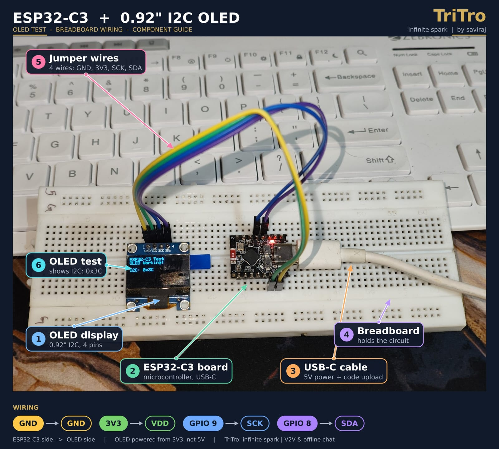
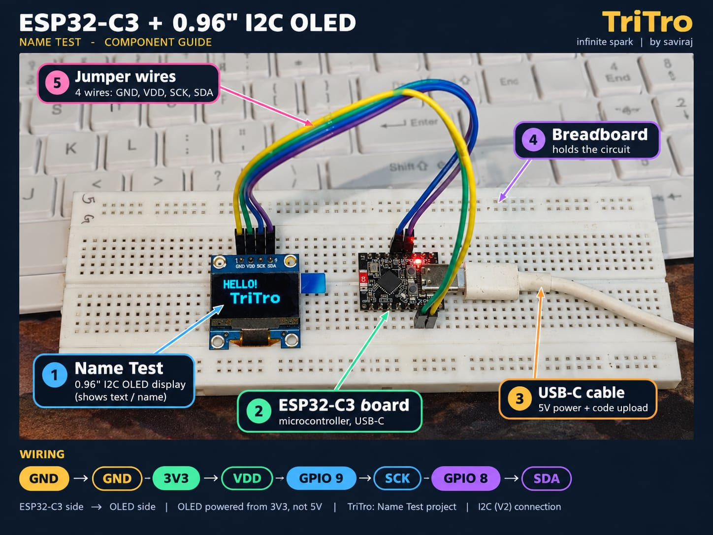
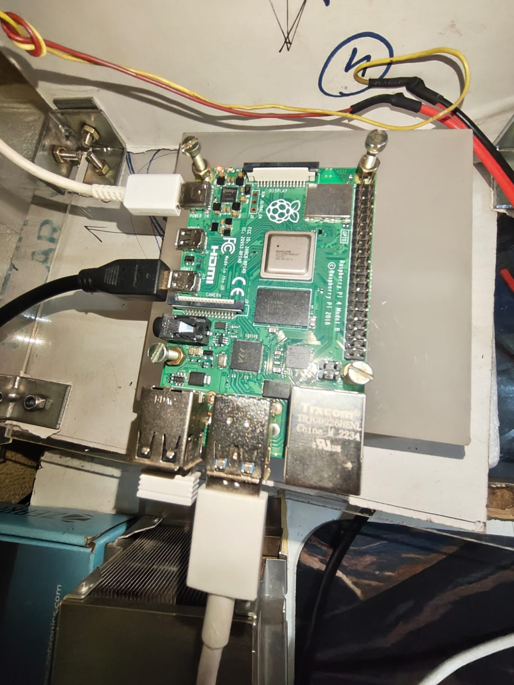

# ESP32-C3 SuperMini — OLED Display Project

## 1. Board Details

- **Board:** ESP32-C3 SuperMini
- **Microcontroller:** ESP32-C3
- **Architecture:** 32-bit RISC-V
- **Wireless connectivity:** 2.4 GHz Wi-Fi and Bluetooth Low Energy (BLE)
- **Development environment:** Arduino IDE
- **Board package:** ESP32 by Espressif Systems
- **USB connection:** USB connection to the Raspberry Pi for programming and serial communication

## 2. OLED Display Details

- **Display:** 0.96-inch OLED
- **Resolution:** 128 × 64 pixels
- **Interface:** I²C
- **Controller:** SSD1306-compatible (assumed)
- **I²C address:** `0x3C`
- **Operating voltage:** 3.3 V

### OLED Wiring

| OLED Pin | ESP32-C3 SuperMini |
|---|---|
| GND | GND |
| VDD | 3V3 |
| SCK / SCL | GPIO 9 |
| SDA | GPIO 8 |

**Important:** Connect the OLED to 3.3 V and verify the pin labels on your specific board before wiring.

---

# ESP32-C3 SuperMini — OLED Display Test

## Objective
Test an I2C OLED display with the ESP32-C3 SuperMini.

## Hardware
- ESP32-C3 SuperMini
- 4-pin I2C OLED display
- Jumper wires

## Wiring

| OLED pin | ESP32-C3 SuperMini |
|---|---|
| GND | GND |
| VDD | 3V3 |
| SCK / SCL | GPIO9 |
| SDA | GPIO8 |

## Arduino IDE Settings
- Board: Select the matching ESP32-C3 board option
- Upload speed: 115200
- Serial Monitor: 115200 baud
- I2C address: 0x3C
- Display configuration: 128 × 64

## Required Libraries
- Adafruit SSD1306
- Adafruit GFX Library

## Test 1 — OLED Working Message
File: `code/oled_test.ino`

Displays:
- ESP32-C3 Test
- OLED Working!
- I2C address

Result: Tested successfully on the physical board.

## Test 2 — Name Display
File: `code/oled_name.ino`

Displays a greeting and a name.

Result: Tested successfully on the physical board.

## Photos
Store actual photographs here:
- `photos/wiring.jpg`
- `photos/oled-test-result.jpg`
- `photos/name-test-result.jpg`

## Troubleshooting
- Check 3V3 and GND.
- Confirm SDA and SCL match the sketch.
- If the display is blank, check the I2C address.
- Confirm the display controller is compatible with the selected library.

## Safety
GPIO8 and GPIO9 are boot-strapping pins on the ESP32-C3. Avoid external circuits that force inappropriate levels during startup.
## Test Results and Photos

### Test 1 — OLED Display Test

Verified that the OLED displays the test message and I2C address `0x3C`.

Raspberry Pi USB connection:

### Test 2 — Name Display Test

Verified that the OLED displays the greeting `HELLO! TriTro`.

Raspberry Pi USB connection:

